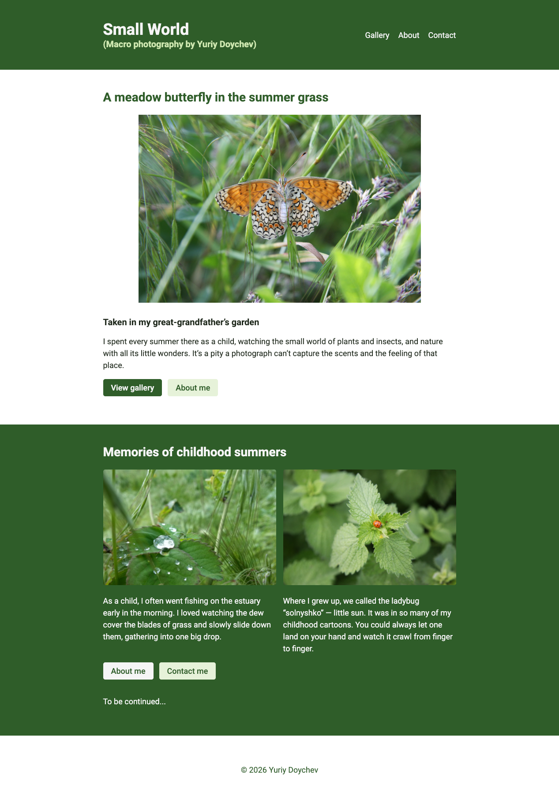
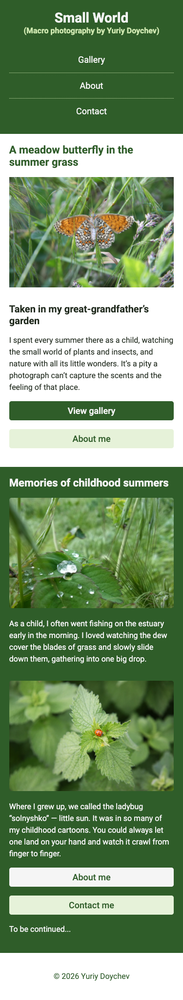

# Small World — Macro Photography

A responsive one-page website showcasing my macro photographs of insects
and plants from childhood summers.

**Live site:** https://small-world-yurdoy.netlify.app/

<p>
  
  
</p>

## About

Built as the "make it your own" project at the end of the Responsive Design
module of the Scrimba Fullstack Developer Path. I started from the course
starter template and replaced all content, images and colors with my own.

## Built with

- HTML5
- CSS3 (Flexbox, media queries, custom properties)
- Vite

## What I learned

- Responsive layout with media queries and Flexbox (`flex-wrap`, `flex: 1 260px`)
- When an image has `width: 100%` in CSS and `width`/`height` attributes in HTML,
  it also needs `height: auto` — otherwise it gets stretched vertically.
  The attributes then only reserve space with the correct aspect ratio,
  which prevents layout shifts while the page loads.
- CSS custom properties (variables) keep the whole color palette in one place,
  so changing a color doesn't mean searching through the entire file.
- WCAG contrast: text and background colors need enough contrast
  (at least 4.5:1 for normal text) to stay readable for everyone.
- CSS specificity: a global `a:hover` rule overrode my `nav a` styles and made
  the navigation links invisible on hover. Adding a more specific
  `nav a:hover` rule fixed it — and DevTools' `:hov` toggle helped me find it.
- Preparing photos for the web: resizing to the displayed width (×2 for Retina),
  compressing, and removing GPS location data before publishing.

## Run locally

```bash
git clone https://github.com/Yurdoy/photography-site.git
cd photography-site
npm install
npm run dev
```
